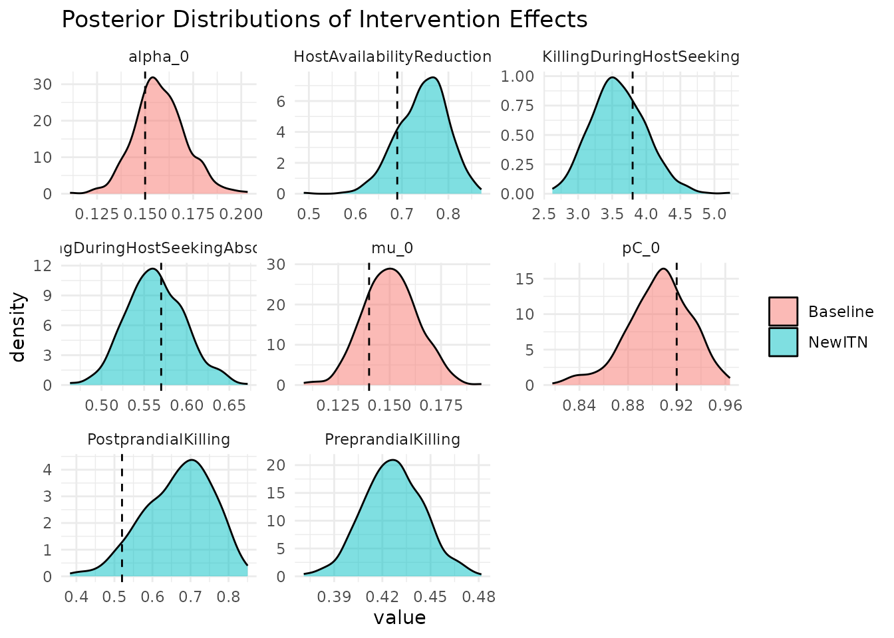
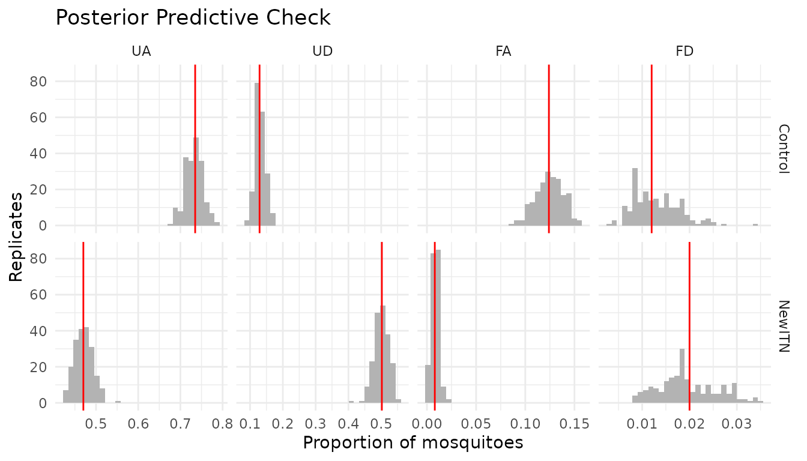
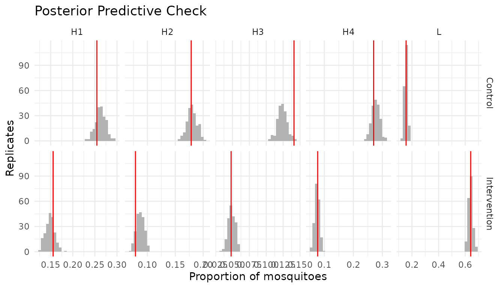

# Workflow: Using Predefined Models

This vignette demonstrates the complete workflow for analyzing
entomological trials data using Bayesian models in the
`AnophelesEntoTrials` package.

## Overview

The package provides two predefined Stan models for different
experimental designs:

| Model | `model_type` | Experimental design | Reference |
|----|----|----|----|
| Basic model | `"basic"` | Experimental hut trials (EHT) | Champagne et al. (2025) |
| Semifield model | `"semifield"` | Matched semifield experiments with a spatial repellent | Denz et al. (2021) |

The workflow is first shown with the basic model; the semifield model is
used in the same way (see [Fitting the Semifield
Model](#fitting-the-semifield-model)).

## Model Descriptions

Both published models are based on a Markov chain model of the mosquito
feeding cycle (Chitnis et al. 2008): during the experiment, a
host-seeking mosquito either finds a host (rate $`\alpha`$) or dies
(rate $`\mu`$).

### Basic Model

For each arm $`i`$ (control $`i = 0`$ or intervention), the
probabilities of the four outcomes observed at the end of the night are:

``` math
p_{UA,i} = e^{-(\alpha_i + \mu_i)}
```
``` math
p_{UD,i} = \left(1 - e^{-(\alpha_i + \mu_i)}\right) \frac{\mu_i}{\alpha_i + \mu_i}
```
``` math
p_{FA,i} = \left(1 - e^{-(\alpha_i + \mu_i)}\right) \frac{\alpha_i}{\alpha_i + \mu_i} \, p_{C,i}
```
``` math
p_{FD,i} = \left(1 - e^{-(\alpha_i + \mu_i)}\right) \frac{\alpha_i}{\alpha_i + \mu_i} \, (1 - p_{C,i})
```

where $`p_{C,i}`$ is the probability of surviving after feeding (the
product $`P_C P_D P_E`$ of Chitnis et al. 2008, not $`P_B`$, the
probability of biting). The intervention modifies the control rates as
follows:

- Reduction in host availability: $`\alpha_i = \alpha_0 (1 - \pi_i)`$
- Pre-prandial killing: $`\mu_i = \mu_0 + \alpha_0 \kappa_i`$
- Post-prandial killing: $`p_{C,i} = p_{C,0} (1 - \xi_i)`$

The counts $`(UA, UD, FA, FD)`$ of each observation (hut-night) follow a
multinomial distribution with these probabilities.

| Parameter | Symbol | Interpretation | Range |
|----|----|----|----|
| HostAvailabilityReduction | π | Reduction in host availability | 0-1 |
| KillingDuringHostSeeking | κ | Pre-prandial killing, relative to the attack rate $`\alpha_0`$ | ≥0 |
| KillingDuringHostSeekingAbsolute | $`\alpha_0 \kappa`$ | Derived: pre-prandial killing as an absolute additional mortality rate | ≥0 |
| PostprandialKilling | ξ | Post-prandial killing | 0-1 |
| PreprandialKilling | \- | Derived: pre-prandial killing efficacy as defined in Champagne et al. (2025) | 0-1 |

Earlier versions of the package named these parameters
`InitialRepellencyRate`, `InitialPostprandialkillingEfficacy` and
`InitialPreprandialkillingEfficacy`.

Baseline parameters: - `alpha_0`: Baseline attack rate (exp(a) in
Stan) - `mu_0`: Baseline mortality rate (exp(m) in Stan) - `pC_0`:
Baseline probability of surviving blood-feeding (inv_logit(b) in Stan)

### Semifield Model

In the semifield experiments of Denz et al. (2021), control and
intervention arms are run on matched nights, and mosquitoes are
collected by human landing catch (HLC) every hour. The outcomes of each
night are the landings in hours 1, 2, 3 and 4-12 ($`H_1, \dots, H_4`$),
the trap catch ($`T`$, absent for a repellent alone) and the mosquitoes
lost to follow-up ($`L`$). Hourly landings make it possible to separate
the reduction in host availability from the killing effect.

The probability of still searching after $`t`$ hours, and of landing on
the host within $`t`$ hours, are:

``` math
P_A(t) = e^{-(\alpha + \mu) t}
```
``` math
P_H(t) = \left(1 - P_A(t)\right) \frac{\alpha}{\alpha + \mu}
```

The outcome probabilities are:

``` math
p_{H_1} = P_H(1)
```
``` math
p_{H_2} = P_A(1) \, P_H(1)
```
``` math
p_{H_3} = P_A(1)^2 \, P_H(1)
```
``` math
p_{H_4} = P_A(1)^3 \, P_H(9)
```
``` math
p_L = 1 - p_{H_1} - p_{H_2} - p_{H_3} - p_{H_4}
```

The rates vary between nights $`k`$:

``` math
\alpha_k = e^{a + \phi_k \sigma_a}
```
``` math
\mu_k = e^{m + \psi_k \sigma_m}
```

The spatial repellent modifies them as in the basic model:

- Reduction in host availability:
  $`\alpha_k^{(1)} = (1 - \pi) \alpha_k`$
- Pre-prandial killing: $`\mu_k^{(1)} = \mu_k + \kappa \alpha_k`$

The outputs `HostAvailabilityReduction` and `KillingDuringHostSeeking`
are $`\pi`$ and $`\kappa`$, and `alpha_H0`, `mu0` are the mean control
rates.

## Step 1: Load the Package

``` r

library(AnophelesEntoTrials)

# See available models, including the data each model requires
knitr::kable(list_available_models(details = TRUE))
```

| model | file | description | required_data | use_case |
|:---|:---|:---|:---|:---|
| basic | eht_basic.stan | Standard multinomial EHT model | UA, UD, FA, FD, treatment | Standard experimental hut trial data with 4 outcome categories |
| semifield | semifield_repellent.stan | Matched semifield model for a spatial repellent (Denz et al. 2021) | y0, y1 | Semifield experiments with time-to-event outcomes (H1-H4, T, L) |

## Step 2: Prepare Your Data

### Basic Model Data Format

The basic model requires: - `UA`: Unfed Alive count - `UD`: Unfed Dead
count - `FA`: Fed Alive count - `FD`: Fed Dead count - `treatment`:
Treatment indicator (0 = control, 1+ = treatments)

``` r

# Example: Import data from CSV with standard column names
eht_data <- import_ento_data("path/to/your/data.csv")
eht_data <- format_eht_data(eht_data)

# Or, if your file uses other column names:
# - list the endpoint columns in required_vars,
# - give the treatment column in treatment_var (renamed to "treatment"),
# - give the product names column in product_var (renamed to
#   "vector_control_product", used to label the results),
# - map the endpoint columns to UA, UD, FA, FD in format_eht_data()
# If the treatment column holds product names and there is no product
# column, format_eht_data() keeps those names in vector_control_product
# before encoding treatment as 0 (control), 1, 2, ...
eht_data_custom <- import_ento_data("path/to/your/data.csv",
                                    required_vars = c("alive", "dead", "alivefed", "deadfed"),
                                    treatment_var = "Intervention",
                                    product_var = "Net_Name")
eht_data_custom <- format_eht_data(eht_data_custom,
                                   mapping = list(UA = "alive", UD = "dead",
                                                  FA = "alivefed", FD = "deadfed"),
                                   control_value = "control")
```

### Simulated Example Dataset

For the purpose of this vignette, we simulate a synthetic dataset from
the basic model with known parameter values, on which we then refit the
model. Since the true values are known, we can check that the model
recovers them (see Step 4).

``` r

# True parameter values used for the simulation
true_baseline <- c(
  alpha_0 = 0.15,   # baseline attack rate
  mu_0 = 0.14,      # baseline mortality rate
  pC_0 = 0.92       # baseline survival probability after blood-feeding
)
true_effects <- data.frame(
  vector_control_product = "NewITN",
  HostAvailabilityReduction = 0.69,           # reduction in host availability
  KillingDuringHostSeeking = 3.8,             # pre-prandial killing multiplier
  PostprandialKilling = 0.52   # post-prandial killing
)  # add rows to simulate several treatment arms

# Simulate 100 hut-nights per arm with 10 mosquitoes each (see ?simulate_eht_data)
n_obs <- 100
n_mosquitoes <- 10
simulated_data <- simulate_eht_data(
  n_obs = n_obs,
  n_mosquitoes = n_mosquitoes,
  alpha_0 = true_baseline[["alpha_0"]],
  mu_0 = true_baseline[["mu_0"]],
  pC_0 = true_baseline[["pC_0"]],
  treatments = true_effects,
  seed = 42
)

# Format the data (adds derived columns)
eht_data <- format_eht_data(simulated_data)
head(eht_data)
#> # A tibble: 6 × 9
#>      UA    UD    FA    FD treatment vector_control_product   fed  dead total
#>   <dbl> <dbl> <dbl> <dbl>     <int> <chr>                  <dbl> <dbl> <dbl>
#> 1     6     3     1     0         0 Control                    1     3    10
#> 2     6     2     2     0         0 Control                    2     2    10
#> 3     7     0     3     0         0 Control                    3     0    10
#> 4     7     1     2     0         0 Control                    2     1    10
#> 5     5     2     3     0         0 Control                    3     2    10
#> 6     5     5     0     0         0 Control                    0     5    10
```

## Step 3: Fit the Model

``` r

# Fewer iterations than the defaults, to keep this vignette quick to build
fit_basic <- fit_ento_model(
  data = eht_data,
  model_type = "basic",
  iter = 2000,
  warmup = 1000,
  chains = 2,
  seed = 123,
  save_y_rep = TRUE,  # keep replicated data for the posterior predictive check
  refresh = 0  # passed to rstan: hide sampling progress
)
#> ℹ Using predefined model: basic
#> ℹ Fitting Stan model...
#> ℹ Iterations: 2000 | Warmup: 1000 | Chains: 2
#> ✔ Model fitting complete
```

### Save and Load Results

``` r

# Save during fitting
fit <- fit_ento_model(
  data = eht_data,
  model_type = "basic",
  output_path = "results/my_fit.rds"
)

# Or save manually
saveRDS(fit_basic, "results/fit_basic.rds")

# Load later
fit_loaded <- readRDS("results/fit_basic.rds")
```

## Step 4: Extract and Interpret Results

### Summary Statistics

``` r

# Extract posterior summaries with 95% credible intervals
summary_results <- extract_stan_summary(
  fit_basic,
  data = eht_data,
  probs = c(0.025, 0.975)
)

print(summary_results)
#> # A tibble: 8 × 6
#>   param                       treatment  mean lower upper vector_control_product
#>   <chr>                           <dbl> <dbl> <dbl> <dbl> <chr>                 
#> 1 PostprandialKilling                 1 0.671 0.481 0.835 NewITN                
#> 2 KillingDuringHostSeeking            1 3.60  2.91  4.35  NewITN                
#> 3 KillingDuringHostSeekingAb…         1 0.564 0.499 0.633 NewITN                
#> 4 HostAvailabilityReduction           1 0.745 0.632 0.838 NewITN                
#> 5 PreprandialKilling                  1 0.427 0.391 0.465 NewITN                
#> 6 alpha_0                            NA 0.158 0.134 0.187 NA                    
#> 7 mu_0                               NA 0.15  0.125 0.176 NA                    
#> 8 pC_0                               NA 0.905 0.848 0.95  NA
```

Since the data were simulated, we can compare the estimates with the
true values:

``` r

true_values <- data.frame(
  param = c(names(true_effects)[-1], names(true_baseline),
            "KillingDuringHostSeekingAbsolute"),
  true = unname(c(unlist(true_effects[1, -1]), true_baseline,
                  true_effects$KillingDuringHostSeeking[1] * true_baseline[["alpha_0"]]))
)

merge(summary_results[, c("param", "mean", "lower", "upper")], true_values)
#>                              param  mean lower upper true
#> 1                          alpha_0 0.158 0.134 0.187 0.15
#> 2        HostAvailabilityReduction 0.745 0.632 0.838 0.69
#> 3         KillingDuringHostSeeking 3.602 2.906 4.353 3.80
#> 4 KillingDuringHostSeekingAbsolute 0.564 0.499 0.633 0.57
#> 5                             mu_0 0.150 0.125 0.176 0.14
#> 6                             pC_0 0.905 0.848 0.950 0.92
#> 7              PostprandialKilling 0.671 0.481 0.835 0.52
```

### posteriorMax Estimates

``` r

# Get posteriorMax estimates (single best estimate)
posteriorMax <- extract_posteriorMax(fit_basic, data = eht_data)
print(posteriorMax)
#> # A tibble: 8 × 5
#>   sample param                            treatment value vector_control_product
#>    <int> <chr>                                <dbl> <dbl> <chr>                 
#> 1   1613 PostprandialKilling                      1 0.644 NewITN                
#> 2   1613 KillingDuringHostSeeking                 1 3.42  NewITN                
#> 3   1613 KillingDuringHostSeekingAbsolute         1 0.553 NewITN                
#> 4   1613 HostAvailabilityReduction                1 0.742 NewITN                
#> 5   1613 PreprandialKilling                       1 0.421 NewITN                
#> 6   1613 alpha_0                                 NA 0.162 NA                    
#> 7   1613 mu_0                                    NA 0.153 NA                    
#> 8   1613 pC_0                                    NA 0.888 NA
```

### Full Posterior Samples

``` r

# Extract subset of posterior samples for further analysis
posterior_samples <- extract_stan_posteriors(
  fit_basic,
  data = eht_data,
  n_samples = 500  # Random subset of 500 samples
)

# Visualize posterior distribution, with the true values as dashed lines
library(ggplot2)

# Baseline parameters have no product, so they are labelled "Baseline"
posterior_samples$product <- ifelse(is.na(posterior_samples$vector_control_product),
                                    "Baseline", posterior_samples$vector_control_product)

ggplot(posterior_samples, aes(x = value)) +
  geom_density(aes(fill = product), alpha = 0.5) +
  geom_vline(data = true_values, aes(xintercept = true), linetype = "dashed") +
  facet_wrap(~ param, scales = "free") +
  theme_minimal() +
  labs(title = "Posterior Distributions of Intervention Effects", fill = NULL)
```



### Posterior Predictive Check

To check that the fitted model reproduces the data, we compare the
observed outcome proportions (red lines) with those of datasets
replicated from posterior draws. This requires fitting with
`save_y_rep = TRUE`.

``` r

set.seed(1)
ppc <- posterior_predictive_check(fit_basic, data = eht_data, n_draws = 200)
ppc$summary
#> # A tibble: 8 × 8
#>   treatment outcome observed median  lower  upper p_value vector_control_product
#>       <int> <fct>      <dbl>  <dbl>  <dbl>  <dbl>   <dbl> <chr>                 
#> 1         0 UA         0.735  0.732 0.690  0.777    0.44  Control               
#> 2         1 UA         0.47   0.471 0.433  0.514    0.51  NewITN                
#> 3         0 UD         0.129  0.129 0.102  0.163    0.52  Control               
#> 4         1 UD         0.502  0.502 0.458  0.542    0.505 NewITN                
#> 5         0 FA         0.124  0.125 0.0970 0.151    0.55  Control               
#> 6         1 FA         0.008  0.008 0.002  0.016    0.605 NewITN                
#> 7         0 FD         0.012  0.012 0.006  0.024    0.565 Control               
#> 8         1 FD         0.02   0.019 0.01   0.0320   0.445 NewITN

plot_posterior_predictive(ppc)
```



## Fitting the Semifield Model

The semifield model follows the same workflow, with
`model_type = "semifield"` and the data listed in Step 1. As for the
basic model, we simulate a dataset similar to the repellent experiment
of Denz et al. (2021), with the effects estimated in that article, and
refit the model.

``` r

set.seed(1)
n_nights <- 20     # matched nights
released <- 100    # mosquitoes released per arm and night
true_semifield <- c(HostAvailabilityReduction = 0.416, KillingDuringHostSeeking = 0.911)

# Night-specific control rates (per hour), with night-to-night variation
alpha <- exp(log(0.3) + rnorm(n_nights, 0, 0.3))
mu    <- exp(log(0.05) + rnorm(n_nights, 0, 0.3))

# Outcome probabilities H1, H2, H3, H4, L (no trap)
semifield_probs <- function(alpha, mu) {
  PA <- function(t) exp(-(alpha + mu) * t)
  PH <- function(t) (1 - PA(t)) * alpha / (alpha + mu)
  p <- c(PH(1), PA(1) * PH(1), PA(1)^2 * PH(1), PA(1)^3 * PH(9))
  c(p, 1 - sum(p))
}

# Outcome matrices of matched nights (one row per night, same order in both arms);
# without a trap, the T column can be left out
semifield_data <- list(
  y0 = t(sapply(1:n_nights, function(k)
    rmultinom(1, released, semifield_probs(alpha[k], mu[k])))),
  y1 = t(sapply(1:n_nights, function(k)
    rmultinom(1, released, semifield_probs((1 - true_semifield[[1]]) * alpha[k],
                                           mu[k] + true_semifield[[2]] * alpha[k]))))
  # if the compartments contained a trap, add its availability per night:
  # beta0 = ..., beta1 = ...
)
```

``` r

fit_semifield <- fit_ento_model(
  data = semifield_data,
  model_type = "semifield",
  iter = 2000,
  warmup = 1000,
  chains = 2,
  seed = 123,
  save_y_rep = TRUE,
  refresh = 0
)
#> ℹ Using predefined model: semifield
#> ℹ Fitting Stan model...
#> ℹ Iterations: 2000 | Warmup: 1000 | Chains: 2
#> ✔ Model fitting complete

# Estimates and true values
extract_stan_summary(fit_semifield)
#> # A tibble: 2 × 5
#>   param                     treatment  mean lower upper
#>   <chr>                         <dbl> <dbl> <dbl> <dbl>
#> 1 KillingDuringHostSeeking         NA 0.934 0.815 1.06 
#> 2 HostAvailabilityReduction        NA 0.383 0.305 0.454
true_semifield
#> HostAvailabilityReduction  KillingDuringHostSeeking 
#>                     0.416                     0.911

# Posterior predictive check
ppc_semifield <- posterior_predictive_check(fit_semifield, data = semifield_data)
plot_posterior_predictive(ppc_semifield)
```



## Troubleshooting and Initialization

### Divergent Transitions

If you see warnings about divergent transitions:

``` r

# Increase adapt_delta
fit <- fit_ento_model(
  data = eht_data,
  model_type = "basic",
  control = list(adapt_delta = 0.99, max_treedepth = 15)
)
```

### Slow Convergence

If Rhat values are \> 1.1:

``` r

# Increase iterations and chains
fit <- fit_ento_model(
  data = eht_data,
  model_type = "basic",
  iter = 20000,
  warmup = 10000,
  chains = 4
)
```

### Understanding Parameter Initialization

MCMC sampling requires starting values (initial values) for all
parameters. The package provides automatic initialization, but
understanding how it works helps with troubleshooting and customization.

#### How Initialization Works

When you call
[`fit_ento_model()`](https://swisstph.github.io/AnophelesEntoTrials/reference/fit_ento_model.md)
with `init = "auto"` (the default), the package:

1.  **Creates an init function** using
    [`generate_inits_basic()`](https://swisstph.github.io/AnophelesEntoTrials/reference/generate_inits_basic.md)
    or
    [`generate_inits_semifield()`](https://swisstph.github.io/AnophelesEntoTrials/reference/generate_inits_semifield.md)
    depending on your model type
2.  **Stan calls this function once per chain** to get different
    starting points
3.  **Each chain starts from a different random location** in parameter
    space

``` r

# See what the init function produces
library(AnophelesEntoTrials)

# Create init function for 2 treatment groups (control + 1 intervention)
init_fn <- generate_inits_basic(nb_treat = 2)

# Call it to see one set of initial values
init_fn()
```

#### Why Multiple Chains with Different Inits?

Different chains starting from different points should converge to the
same posterior distribution if: - The model is well-specified - There’s
enough data - The sampler has run long enough

If chains don’t converge (Rhat \> 1.1), it may indicate: - Insufficient
iterations - Model identifiability issues - Need for better
initialization

#### Customizing Initialization

You can provide your own init function for more control:

``` r

# Custom init function with specific starting values
my_inits <- function() {
  list(
    PostprandialKilling = c(0.1, 0.5),  # control, treatment
    KillingDuringHostSeeking = c(0.1, 0.5),
    HostAvailabilityReduction = c(0.1, 0.5),
    a = -2,  # log(alpha_0) ≈ log(0.14) = -2
    m = -2,  # log(mu_0) ≈ log(0.14) = -2
    b = 2    # logit(pC_0) ≈ logit(0.88) = 2
  )
}

# Use custom inits
fit <- fit_ento_model(
  data = eht_data,
  model_type = "basic",
  init = my_inits
)
```

#### Parameter Scales in Stan

The Stan models use transformed scales for baseline parameters:

| R Parameter | Stan Parameter | Transformation        | Typical Range |
|-------------|----------------|-----------------------|---------------|
| `alpha_0`   | `a`            | `alpha_0 = exp(a)`    | a ∈ (-4, 0)   |
| `mu_0`      | `m`            | `mu_0 = exp(m)`       | m ∈ (-4, 0)   |
| `pC_0`      | `b`            | `pC_0 = inv_logit(b)` | b ∈ (-2, 4)   |

When providing custom inits, specify values on the **transformed scale**
(a, m, b) not the natural scale.

## Assumptions and Limitations

- Huts and hut entry are not modelled: $`\pi`$ is a reduction in host
  availability, not a reduction in hut entry.
- Pre-prandial killing uses the scaled definition
  $`\mu_i = \mu_0 + \alpha_0 \kappa_i`$; the absolute additional
  mortality is $`\alpha_0 \kappa_i`$ (output
  `KillingDuringHostSeekingAbsolute` of the basic model). There is
  currently no evidence base to choose between the two definitions, and
  the choice affects predictions.
- The baseline rates ($`\alpha_0`$, $`\mu_0`$) are estimated under
  experimental conditions and need not reflect field conditions.
- The basic model does not include disarming (mosquitoes prevented from
  feeding without being killed).
- In the semifield model, $`\kappa`$ combines killing and disarming,
  which can only be separated with additional experiments. Post-prandial
  killing is not estimated: it requires a separate experiment on the
  mortality of mosquitoes caught by HLC.
- The semifield model assumes the experimental schedule of Denz et
  al. (2021): HLC in hours 1, 2, 3 and 4-12 of a 12-hour night.

## References

- Champagne C, Lemant J, et al. (2025). Cascades of effectiveness of
  next-generation insecticide-treated nets against malaria, from
  entomological trials to real-life conditions. *Nature Communications*
  16:11162. <https://doi.org/10.1038/s41467-025-66130-y>
- Chitnis N, Smith T, Steketee R (2008). A mathematical model for the
  dynamics of malaria in mosquitoes feeding on a heterogeneous host
  population. *Journal of Biological Dynamics* 2(3):259-285.
  <https://doi.org/10.1080/17513750701769857>
- Denz A, Njoroge MM, et al. (2021). Predicting the impact of outdoor
  vector control interventions on malaria transmission intensity from
  semi-field studies. *Parasites & Vectors* 14:64.
  <https://doi.org/10.1186/s13071-020-04560-x>

## Next Steps

- See
  [`vignette("workflow-custom-models")`](https://swisstph.github.io/AnophelesEntoTrials/articles/workflow-custom-models.md)
  for using custom Stan models
- See
  [`?extract_stan_summary`](https://swisstph.github.io/AnophelesEntoTrials/reference/extract_stan_summary.md)
  for more extraction options
- See
  [`?list_available_models`](https://swisstph.github.io/AnophelesEntoTrials/reference/list_available_models.md)
  for model details
